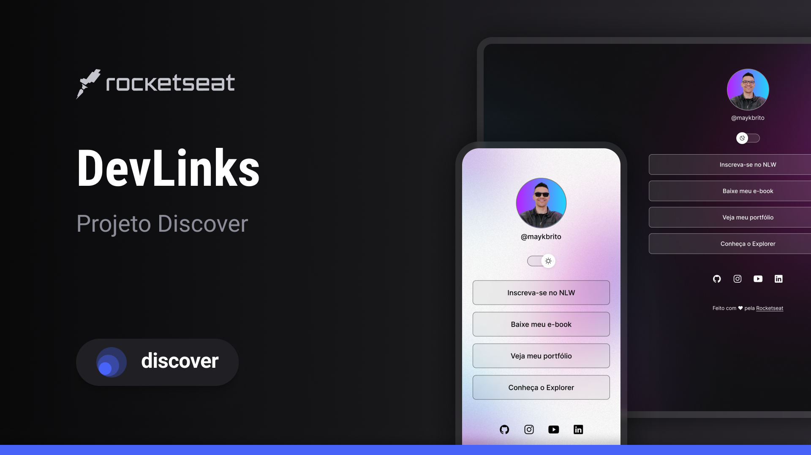

<h1 align='center'> DevLinks </h1>

Projeto desenvolvido a partir dos conceitos apresentados no curso <strong>Discover</strong>, da Rocketseat, com foco na prática de tecnologias fundamentais para desenvolvimento web.  

  <a href='#-tecnologias'>Tecnologias</a>&nbsp;&nbsp;&nbsp;|&nbsp;&nbsp;&nbsp;
  <a href='#-projeto'>Projeto</a>&nbsp;&nbsp;&nbsp;|&nbsp;&nbsp;&nbsp;
  <a href='#-aprendizados'>Aprendizados</a>&nbsp;&nbsp;&nbsp;|&nbsp;&nbsp;&nbsp;
  <a href='#-layout'>Layout</a>&nbsp;&nbsp;&nbsp;|&nbsp;&nbsp;&nbsp;
  <a href='#memo-licença'>Licença</a>

  

 

  

## 🚀 Tecnologias

Esse projeto foi desenvolvido utilizando:

- HTML
- CSS
- JavaScript
- Git e GitHub
- Figma

## 💻 Projeto

O **DevLinks** é um agregador de links desenvolvido para funcionar como um cartão de visitas digital, reunindo em um único lugar meus principais perfis, projetos e formas de contato.

A aplicação foi construída por mim a partir dos conceitos apresentados durante o curso DevLinks da Rocketseat, adaptando o conteúdo aprendido para criar a minha própria versão do projeto.

O objetivo foi praticar conceitos fundamentais de desenvolvimento web e transformar o exercício proposto em uma interface personalizada para o meu perfil.

## 📚 Aprendizados

Durante o desenvolvimento deste projeto, coloquei em prática conceitos como:

- estruturação de páginas com HTML;
- estilização e organização visual com CSS;
- manipulação de elementos com JavaScript;
- criação de layouts responsivos;
- utilização de variáveis CSS;
- interação com elementos da interface;
- organização e versionamento do projeto com Git;
- publicação e documentação de projetos no GitHub;
- interpretação de layouts desenvolvidos no Figma.

## 🔖 Layout

O projeto original utilizado como base de estudo possui um layout disponibilizado pela Rocketseat no Figma.

Você pode visualizar o layout original através [DESSE LINK](https://www.figma.com/community/file/1187422022288947321).

É necessário ter uma conta no [Figma](https://figma.com) para acessá-lo.

A versão presente neste repositório foi personalizada durante o processo de desenvolvimento para representar meu próprio perfil e aplicar os conceitos aprendidos no curso.

## 📝 Licença

Esse projeto está sob a licença MIT.

---

Desenvolvido por [Sofia Sabrina](https://github.com/sofiasbrinas) durante meus estudos de desenvolvimento web. 💻
